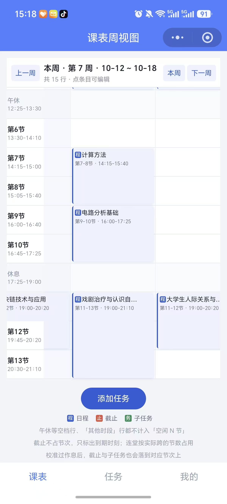
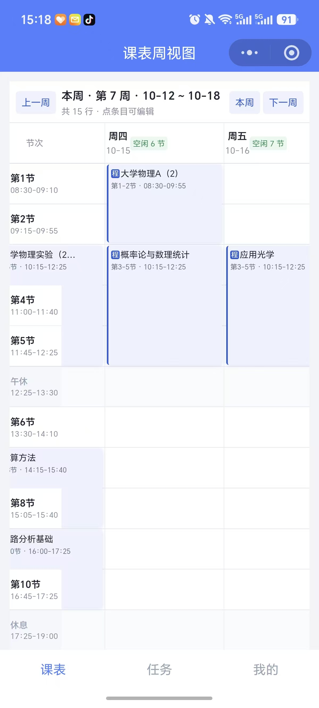
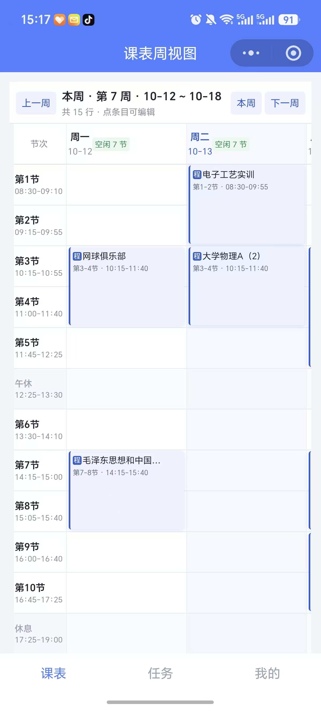
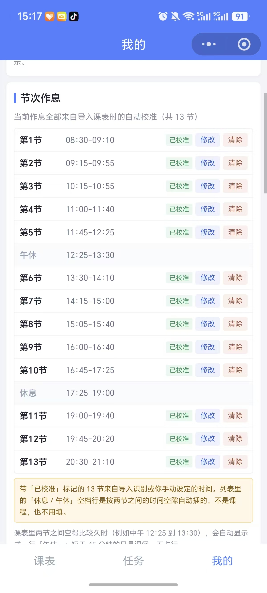
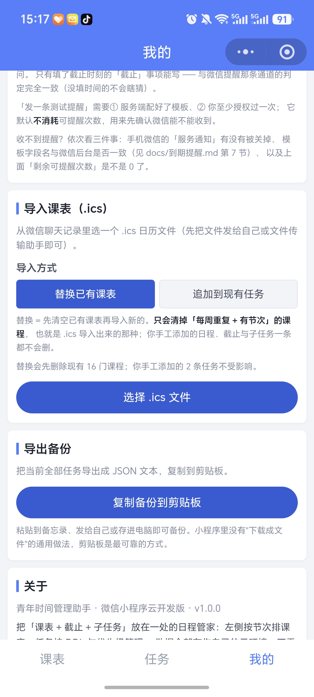

# 智能日程管家 Smart Scheduler

> 深圳大学 物光创新实验室 2026 年招新 · 个人项目
> 作者：何启畅 · 学号：2025270057 · 光电信息科学与工程 2025 级
> Python 3.14 + Streamlit · 微信小程序（云开发）

把「记日程」这件事交给 AI：你说一句话，它自动解析成课表上的安排；你说一个大任务，它自动拆成能执行的步骤。

---

## 一、为什么做这个：一个真实存在的痛点

我是一名大二学生，我的时间不是"几点开会"，而是一张按节次排的课表，加上一堆交错出现的 DDL。为了做这个项目，我先看了自己实际是怎么"记事情"的：

| 我试过的工具 | 它的问题（我自己的使用感受） |
|---|---|
| 手机日历 | 加一件事要填标题、选日期、选起止时间、选重复… 填一次 30 秒，一句话的事被拆成五步表单 |
| 待办清单类 App | 只有"清单"，没有时间轴，看不出"周四上午三四节有课，这一天还剩哪段空着" |
| 课程表类 App | 只管上课，不管作业和 DDL，而 DDL 才是大学生焦虑的来源 |
| 备忘录 | 能记但不会提醒，也不会排 |

所以我想要的其实是一件很具体的事：

> 用一句自然语言把事情说出来 → AI 把它变成课表上的一条安排 → 我确认一下 → 它就在那儿了。

三个关键设计就从这里来：

1. 时间刻度必须是"节次"，不是"上午/下午"。大学生的生活是按第几节课走的。"周三下午两点到三点四十"和"周三第 7-8 节"是同一件事，但后者才是我看得懂的表达，而且三节连堂（第 7-9 节）必须能一眼看出占了三个格子。
2. AI 解析的结果必须让我过一眼再落盘。AI 算错日期是常态，所以解析结果是逐条确认卡片（可以改、可以删），点"确认添加"才写进数据。
3. 数据必须留在我自己的电脑上。课表、作业、DDL 都是私人信息，所以单机自用这一版用本地 JSON 文件存储，不需要注册账号、不连任何服务器。（后来为了「让同学也能用手机记」，多了多用户版与微信小程序版：前者跑在自己的服务器上、用 SQLite 按空间码隔离，后者用微信云开发按微信身份隔离；两条路都是显式开启的，单机自用的行为一点没变，见第七、八节。）

---

## 二、它能做什么

> 这一节说的是电脑浏览器那一版（Python / Streamlit）；手机上的微信小程序版见第八节。
> 手机端（微信小程序）的实机截图在第八节；电脑端的截图清单见 `docs/演示提纲.md` 第三节。

| # | 功能 | 说明 |
|---|---|---|
| 1 | 自然语言录入 | 输入"明天下午三点开组会，这周五前交实验报告"，自动解析成结构化日程；支持"明天/后天/这周五/下周三/10月15号/三天后"等相对与绝对表达 |
| 2 | 逐条确认后入库 | 解析结果显示成卡片，每条可 ✏️ 编辑、🗑️ 移除，点"✅ 确认添加"才写入数据 |
| 3 | 节次课表周视图 | 行 = 节次（由你的课表决定：默认 1~13 节，导入的课表里有第 14 节就自动多一行），列 = 周一到周日；课程卡片按颜色区分类型；连堂课用合并单元格占满 2~3 格；今天整列高亮；没课的午休时段单独成行 |
| 4 | 课程表一键导入 | 支持 `.ics`（WakeUp 课程表 / 超级课程表 / 手机日历导出）、`.csv`、`.json`，自动识别格式；双周课自动合并成一门课；学期起点与上下课时间自动校准 |
| 5 | 周次 / 单双周 | 课程可设"第 1~16 周、双周"；课表按当前是第几周显示，可前后翻周 |
| 6 | 三种状态 | 已结束（这次课过点了，淡显）· 已结课（整门课上完了，自动从待办收起）· 已完成（手动打勾） |
| 7 | 日程管理 | 逐条修改 / 完成切换 / 删除（二次确认）；筛选：进行中 / 已完成 / 已结束 / 全部 |
| 8 | 截止提醒 | 未来 7 天的 DDL，按紧急度排序，≤2 天转红色告警并显示剩余天数 |
| 9 | 导出 / 备份 | 导出 CSV（带 BOM，Excel 打开不乱码）和 JSON，JSON 可再导入回来 |
| 10 | 手机可用 | 手机连同一 WiFi 用浏览器打开即可；有专门的「📱 今日」列表视图（手机上比宽表格实用），窄屏自动适配 |
| 11 | 一键启动 | 双击 `启动.bat`：自动检查依赖、缺依赖自动装、自动生成 `.env`、端口被占自动顺延 |
| 12 | 本周时间缺口 | 给任务填「预计耗时」，自动算「本周空档 vs 这周要做」；排不下时直接告诉你差多少、哪天空档最多。没估耗时的任务不计入需求，单独列出（不假装知道） |
| 13 | AI 拆解成子任务 | 一条日程/DDL 点 🤖 → AI 给出若干带建议日期与耗时的步骤 → 逐条确认（可改日期/耗时/去掉）后才落盘，自动挂在父任务下；删父任务级联删子任务 |
| 14 | 导出 `.ics` | 导出成系统日历 / 手机日历能读的日历文件；本项目自己的导入器能原样读回来（往返一致） |
| 15 | 可复跑的测试 | `tests/` 用标准库 `unittest` 写成（`python -m unittest discover -s tests -t .`），`pytest` 也兼容；真实数据强制隔离 + SHA256 复核 |
| 16 | 部署就绪 | Dockerfile / docker-compose / `.streamlit` 配置 / 中文部署指南（局域网扫码、Streamlit Cloud 免费公网、Docker 三条路线，含排查表） |
| 17 | 多用户 / 空间码 | 免注册：第一次打开自动发一个空间码（写进 URL），每人一份独立日程、互相看不到；面板里可查看空间码、输码进入别人的设备、扫码带过去、导出自己的数据、两步删除整个空间 |
| 18 | 手机当 App 用 + 云部署 | `deploy/` 里有 Docker + Caddy（自动 HTTPS）+ 持久卷 + 备份脚本 + 中文部署指南；手机浏览器「添加到主屏幕」后有独立图标与全屏（PWA：manifest + service worker + 图标），空间码在链接里不用再输 |

---

## 三、设计思路

### 3.1 三层架构，依赖单向

```
main.py（页面装配，不碰业务逻辑）
   │
   ├── ui_components.py   界面：所有渲染与交互（不直接读写数据文件）
   ├── task_manager.py    数据与领域规则：增删改查、周次匹配、状态判定
   └── ai_parser.py       唯一的网络出口：调用大模型（默认智谱，可切 DeepSeek），文本 → 结构化数据
            │
        importer.py       多格式导入：.ics / .csv / .json → 任务
            │
         config.py        所有常量的唯一来源（作息表、类型、优先级、路径）
```

为什么这样分：界面层永远只调用 `task_manager` 的函数，不碰 JSON；AI 层只负责"文本 → dict"，不负责写盘。

这个分层在小程序版上得到了验证。Python 跑不起来，所以不是"整个复用"，而是把四个纯逻辑模块（`config` / `planner` / `task_manager` / `importer`）逐条移植成 JS。移植能做得这么机械，而不是另写一套规则，正是因为界面与业务规则本来就分开。移植结果也是可验证的：同一份 `.ics` 同时喂给 Python 与 JS 逐字段比对，13 项检查全过（另有 6 处已登记的等价差异），详见第八节。

### 3.2 为什么让 Python 算日期，而不是让 AI 自己推

LLM 最容易出错的地方就是相对日期换算（"下周三"是几号）。我的做法是不给它猜的机会：

1. 每次调用前，Python 先算出日期参考表注入 system prompt：今天是几号周几、明天/后天/大后天、本周一到周日、下周一到周日的绝对日期；
2. 再动态生成 3 条 few-shot 示例（示例里的日期也是按今天算好的真实日期）；
3. 配上硬规则：这周五若已过则顺延到下周、只写月日则取"今天之后最近的那一年"、十二小时制"下午/晚上 +12"、"半=30 分、一刻=15 分"。

实测结果（`今天 = 2026-09-22`，当时默认服务商还是 DeepSeek）：输入"明天下午三点开组会，这周五前交实验报告，10月15号上午九点半体检"，得到 `09-23 15:00`、`09-25`（DDL）、`10-15 09:30`，三条全对。（后来默认换成了智谱 GLM 免费档，那条路没有做过真实联网验证，见第五节。）

### 3.3 为什么 AI 返回要"容错解析"

模型返回的 JSON 经常带瑕疵：外面裹 ```` ```json ````、前后有解释文字、尾逗号、中文引号。所以解析做了四级降级（整段 → 剥代码块 → 截取最外层大括号 → 修尾逗号/中文引号），每级都用 `try-except` 包住 `json.loads`，全失败就返回友好错误而不抛异常。

### 3.4 为什么"已结课"是实时算的，而不是写进数据

最直觉的实现是"结课了就把 `done` 设成 true"，但这个项目里侧边栏有个「一键清空已完成任务」按钮，它是删除已完成的任务。如果自动把整学期的课标成"已完成"，用户点一下那个按钮，一学期的课表就没了。

所以"已结课"是按当前周次实时计算的派生状态：不污染数据、改学期起点或周次时会自动跟着变。

同理，三种状态刻意分开，因为粒度不同：

- 已结束 = 这一次课过点了（下午三点时，今早的课就是已结束）
- 已结课 = 整门课的最后一次课上完了
- 已完成 = 用户手动打勾

而自己手动加的一次性日程永远不会自动结束（哪怕日期已经过了），必须手动处理，因为"昨天下午三点的会议"到底是没去还是已经做完了，只有人知道。

---

## 四、我遇到的问题与解决过程

> 这一节是项目的核心。下面每一条都是真实发生的：现象 → 定位 → 根因 → 修复 → 验证。
> 大部分问题不是"看代码看出来的"，而是写自动化测试、用真实课表跑的时候暴露的。

### 问题 1：数据文件带 BOM，程序静默读空

程序看起来正常，但任务永远是 0 条。测试里断言"初始应为空列表"通过了，我却起疑，因为我先前明明写进去过数据，于是直接打印文件原始字节，看到 `b'\xef\xbb\xbf[]'`。**根因是** Windows PowerShell 的 `Set-Content -Encoding utf8` 会写 UTF-8 BOM，而 Python 用 `encoding="utf-8"` 读取时把 BOM 当成非法字符，`json.loads` 抛异常，被我的容错逻辑吞掉，于是返回 `[]` —— 最危险的地方在于它"看起来能用"。

**修法是**写入端保证无 BOM，读取端改用 `utf-8-sig` 兼容带 BOM 的文件。验证时既断言文件字节是 `b'[]'`，又单独造一个带 BOM 的文件验证能被正确读出。

### 问题 2：AI 说"DDL"，程序却存成了"日程"

从自然语言添加"交实验报告"，最终存进去的 `type` 是 `event` 而不是 `ddl`（红色卡片变成了蓝色）。集成测试里断言类型、打印落盘结果，看到的是 `(3, '真实DDL', 'event', ...)`。**根因是**中文标签映射表里我只写了小写 `"ddl"` 和中文 `"截止"`，而模型返回的是大写 `"DDL"`，查表失败后静默回退成默认值 `event`。

**修法是**把映射改成大小写容错（先精确、再转小写），并抽出 `type_to_const()` / `priority_to_const()` 供全项目共用。验证方式是 `DDL / ddl / Ddl / Event / Low` 等写法逐一断言。

### 问题 3：错误处理把"页面刷新"也吞掉了

点"添加任务"后提示成功，但页面不刷新，新任务要手动刷新才出现；测试里点击按钮后没有触发 rerun 信号。**根因是**我给每个区域加了错误边界（`safe_render`），任何异常都渲染成友好错误卡片，而 Streamlit 的 `st.rerun()` 本身就是通过抛异常实现的（`RerunException`），被我的 `except` 当成普通错误吞了 —— 防崩溃的同时，把"刷新"也一起防掉了。

**修法是**让错误边界识别控制流异常并原样抛出，先尝试 import 真实异常类做精确判断，同时保留按类名兜底（不同 Streamlit 版本里异常类所在的模块路径不同）。验证时分别构造"普通异常→显示错误卡片"和"Rerun 信号→必须抛出"两种断言。

### 问题 4：只是打开编辑框再保存，就改坏了数据

一条开始时间 `15:00`、没有结束时间的日程，点开编辑再保存，就变成了 `15:00-10:00`。集成测试打印编辑后的条目，`end_time` 从 `''` 变成了 `'10:00'`。**根因是**编辑表单里时间控件必须有默认值（`st.time_input` 不支持空），我用了固定的兜底值 10:00，保存时无条件写回，于是"用户没填的字段"被凭空造了出来。

**修法是**原本为空、且控件值仍等于兜底默认值时继续保持为空（`no_time_default` 参数区分"编辑已有任务"和"新建任务"）。验证断言"空的结束时间未被捏造""原有开始时间保留""日期未被改动"。这次重构还引出一个回归：新建任务的"不指定具体时间"因为空任务没有时间而被默认勾上，导致用户选好的时间被丢弃；测试里"新课程落在第 7-8 节行"失败暴露了它，用独立的 `no_time_default=False` 修掉。

### 问题 5：WakeUp 导出的 .ics 把"双周课"拆成了 6 条

导入自己的课程表后，`应用光学实验` 这门双周课变成了 6 条独立任务（10-06、10-20、11-03…），日程管理列表被撑爆。读自己的 `.ics` 源文件发现，导出的 6 个 `VEVENT` 虽然都写 `RRULE:FREQ=WEEKLY`，但每条的 `UNTIL` 只覆盖当次（例如 `DTSTART 10-06` 配 `UNTIL 10-12`），也就是说每次课被导出成一个"只重复一次"的事件。

**修法是**在解析时按「课程名 + 时间 + 地点」把散落的事件归并，再把它们出现的周次排序，推断出规律：周次连续就是"每周"，周次全是同奇偶且间隔 2 就是"单周/双周"。于是 6 条事件被正确还原成 1 门"第 6-16 周双周"的课。验证断言 `应用光学实验` 只有 1 条、`week_parity=even`、`week_start=6`、`week_end=16`。

### 问题 6：ICS 里藏着的第二条 DESCRIPTION，把课程信息覆盖了

导入成功、课程和时间都对，但节次全是空的（"第 7-9 节"没解析出来），导致课程落不到正确的课表行。`DESCRIPTION` 解析函数单独拿出来测是好的，于是打印事件对象，发现 `description` 是 `电子工艺实训@致腾楼316B`，那是闹钟提醒的文案，不是课程描述。**根因是** ICS 的每个 `VEVENT` 里还嵌着 `VALARM` 子组件，它里面也有一条 `DESCRIPTION`；我的解析器没有区分嵌套层级，后出现的把先出现的覆盖了。

**修法是**解析时维护组件嵌套深度，只取 `VEVENT` 第一层的属性。验证断言每门课都有非空节次（16/16）。

### 问题 7：时区——UTC 的 UNTIL 和本地时间比，少算一周课

`电子工艺实训` 的结束周算出来比预期早一周。对照源文件看到 `DTSTART;TZID=Asia/Shanghai:20260901T083000`（本地时间 08:30）与 `RRULE:...UNTIL=20270104T160000Z`（UTC，`16:00Z` 即北京时间次日 00:00）。**根因是**我把所有时间都当本地时间处理，UNTIL 被当成"1 月 4 日 16:00 本地"，于是 12 月 29 日之后的课被误判为超出范围。

**修法是**从 `VTIMEZONE` 读 `TZOFFSETTO`，只对带 `Z` 的值做 UTC→本地换算。验证断言该课程为第 1-18 周（修复前是 17 周）。

### 问题 8：.bat 里写中文，cmd 报"不是内部或外部命令"

双击启动脚本，报一串莫名其妙的错误：

```
'��先到' is not recognized as an internal or external command
'ghua.edu.cn' is not recognized ...        ← URL 被从中间截断
```

`cmd.exe` 按系统 OEM 代码页（中文 Windows 是 GBK）解析批处理文件的字节，而我的文件是 UTF-8 —— 一个中文 3 字节，会把命令行切碎，`echo` 前缀丢失、后半截被当成命令执行。**修法是**让 `.bat` 只放 ASCII（含 `chcp 65001` 和 `PYTHONIOENCODING=utf-8` 两行环境设置），所有中文提示搬到 Python 启动器 `launcher.py`，由 Python 自己控制编码。

改完仍报 `'Smart' is not recognized`。查文件字节发现是 41 个 LF、0 个 CRLF，而 cmd 要求批处理用 CRLF 换行，纯 LF 会让 `REM` 行解析错乱；转成 CRLF 后零报错。

### 问题 9：Windows 上文件被占用，写盘偶发失败

测试里"加了 5 条，实际只进了 4 条"，且没有任何报错 —— `add_task` 静默返回了 `False`。我在测试里给 5 次 `add_task` 的返回值加断言，立刻定位到是哪一条失败；再打开日志看到 `替换数据文件失败`。**根因是** Windows 上 Defender / 文件索引 / 编辑器会短暂占用文件，`os.replace`（原子替换）偶发失败，而我原来只尝试一次就放弃。

**修法是**写入改成"临时文件 + 带线性退避的重试替换"（5 次），偶发占用能自愈，同样的重试也用在设置文件上。验证断言 5 条全部写入成功，并且此后再未复现。（这个 bug 还以 `ReplaceFileW EIO` 的形式影响过编辑器一次，是真实环境问题而不是测试噪音。）

### 问题 10：手机上 13×8 的课表根本没法看

手机浏览器打开后，课表挤压成一条条看不清的窄柱。这不是 bug 而是设计问题 —— 桌面的"13 行 × 8 列"表格在 400px 宽的屏幕上必然失败。

**修法是**两手准备：一是窄屏媒体查询（缩小字号/内边距）加上表格外层的横向滑动容器；二是新增「📱 今日」列表视图，今天几节课、几点、在哪、上完没有，一屏读完，这才是手机上真正好用的形态。验证断言窄屏媒体查询已注入、表格有横滑容器、今日视图不渲染表格、已过课程淡显标"已结束"。

### 问题 11：校准出的作息和默认作息重叠，课程落错行

三节连堂的 `应用光学实验`（14:15 开始）被算成占第 5-9 节，而不是第 7-9 节。**根因是**从课表校准出"第 7 节 = 14:15 开始"之后，默认作息里"第 5 节 = 14:00-14:45"仍然包含 14:15；按"第一个命中的行"取，就取到了第 5 节。

**修法是**改为按"最贴近"匹配：判断开始取开始时间最接近的课，判断结束取结束时间最接近的课。验证时跨度断言 `(7, 9)`、`(3, 5)`、`(3, 4)` 全部正确。

### 问题 12：撞课时每张卡都撑满整格，卡片错位、下面还露出"空闲"

把子任务排到已经有的课上（12:00-13:30 的子任务碰上 10:15-12:25 的课），卡片不在它自己那一节上，而且它盖住的那一行背景里还印着"空闲"两个字。我先把 `AppTest` 真正渲染出来的表格 HTML 打出来逐格统计，发现"同一格里既出现卡片又出现`空闲`"的次数是 0，字面上并没有冲突；真正的问题是那一格同时挂了两张卡片：`应用光学`（第 3-5 节）和子任务（第 5 节）。

**根因是**合并单元格（`rowspan`）里渲染多张卡片时，我给每一张都加了"撑满整格"的样式（`height:100%`）。两张卡就是 200% 高，必然溢出到下面那一行，而那一行恰好是没课的「空闲」格，于是既是"卡片错位"，又是"空闲没去掉" —— 两个现象其实是同一个 bug。

**修法是**格子里只有一条日程时保持原样（连堂课仍然是一整块，中间无缝）；有两条以上时并排成几列，每列内部用 `flex-grow = 这条日程占的节次行数` 精确占位，并用 `height: calc(100% + 2px)` 把单元格的内边距/边框误差补回来，让卡片边界和左侧节次行对齐；撞课的两张卡都加 `⚠ 撞课` 角标。验证用真实数据整表断言：子任务那一列必须是"前面空 2 行 + 自己占 1 行"、全表不存在"同一格既有卡片又有`空闲`"、每列的行数之和等于整格行数；再把修复前后 14 个连堂格逐字节比对，只有受影响的那 1 格变化；真实 `data/*.json` 的 SHA256 前后一致（测试全程只读真实数据，跑在工作区副本上）。

### 问题 13：课表里显示的"第6节"，其实是别的学校的默认作息

课表左侧出现一行"第6节 14:55-15:40"，夹在第 5 节（11:45）和真实的第 7 节（14:15）之间：时间不按顺序，而且这一行 7 个格子全都是"空闲"。我先把真正渲染出来的表格 HTML 打出来逐行统计，确认那一行 7 格全写着"空闲"，说明它根本没被任何课占用；再去读 `period_time_range()`，发现没被校准到的节次会返回 `config.py` 里写死的默认作息（第 6 节 = 14:55-15:40）。

**根因是**默认作息本来只给"还没导入课表"的情况兜底；一旦导入了课表，说明我的真实作息已经被校准出来了，这时还把默认值当成"我的第 6 节"来显示，等于把别的学校的作息当成了我的。回头核对 `.ics` 原文：整份课表只用到第 1-2、3-4、3-5、7-8、7-9、9-10、11-12、11-13 节，从来没有出现过第 6 节，这个节次确实不在我的课表里。

**修法是**把"左右紧邻两节之间、恰好缺一节"的空档认定为这一节的时间：中午那段（12:25-14:15）显示成午休。它是空档、不是课，所以占位字写"午休"而不是"空闲"，也不计进"空闲 N 节"；同时让这段空档真的能接住任务，12:30-13:30 的子任务会直接排进午休那一行。算不准就不猜 —— 完全没校准、连着缺好几节、缺表头/表尾，都按原来的默认作息走。验证分三层：纯函数断言（空档认定、行名、时刻匹配）、整表断言（左侧显示"午休 12:25/14:15"、假的"第6节"和"14:55"彻底消失、空着的午休格子写"午休"、不存在"同一格既有卡片又有空闲"）、保守性断言（不该认成午休的都不认）；子任务按"它自己的时间该占哪几行"核对；真实 `data/*.json` 的 SHA256 前后一致。

### 问题 14：一天几节课被写死成 13，别人课表里的第 14 节没地方放

**起因是**一个提问："我们学校一天 14 节课，只是我这学期没有第 14 节——那有第 14 节的人导入课表，能正常显示吗？"实测答案是不能：他的课会被塞进"其他时段"，或者只占第 13 节那一行。

我造了一份含"第13 - 14节 21:00-22:30"的 `.ics`，走完整导入链路并逐步打印，看到节次解析是对的（`periods = "13-14"`），但有两处卡住：一是 `_calibrate_periods()` 只迭代 `config.CLASS_PERIODS`（写死 13 节），第 14 节的上下课时间永远学不到；二是 `row_index_of_period(14)` 返回 `None`，课表只有 13 行，"第13-14节"的课被截成 1 行，整条都在第 14 节的课直接掉进"其他时段"。根因是行集合被写死成"默认作息的 13 节"，可学校的节次数并不统一（13 节、14 节都有），既然课表已经导入了，行就该由数据决定，而不是由我预先假设的那个数字决定。

**修法是**把行集合改为 `默认作息的节次 ∪ 校准到的节次 ∪ 任务里写过的节次`（`config.period_numbers()`），校准函数也改成按"事件里真正出现过的节次"存时间。于是别人导入带第 14 节的课表，第 14 节那一行会带着它自己的时间出现，课正常占两行（第 13-14 节连堂）。

改完又遇到一个问题：第一版第 14 节仍然不出现。原因是 `_week_table_html()` 的参数叫 `rows`，而函数开头又写了 `rows = []`，参数被同名局部变量遮蔽，`rows if rows else 默认行` 读到的一直是那个空列表，静默退回 13 行；把局部变量改名成 `display_rows` 才正常。教训是参数和内部变量重名时，`if 参数 else 默认值` 会悄悄走默认分支，所以断言必须打到"渲染结果"上，不能只断言函数返回值（我的纯函数断言当时全是 PASS）。

验证分五步：A 节次集合（含边界：不传 rows 时第 14 节仍不在默认表里）；B 完整 ICS→解析→校准链路（第 14 节时间学到 `21:45-22:30`）；C 真渲染（左侧出现"第14节"且带时间、卡片跨 2 行、"空闲 N 节"的分母跟着变成 14 节）；D 回归（只有 13 节的数据，整张表逐字节一致，含午休行）；E 真实 `data/*.json` 的 SHA256 前后不变。

### 问题 15：缺口分析第一版按"写死的 13 节"算

给「本周还排得下吗」写第一版时，我让 planner 用 `config.PERIOD_ROWS[index]` 把行下标换回节次。但课表的行列表是动态的（问题 14：导入的课表有第 14 节就多一行），而 `config.PERIOD_ROWS` 只是默认的 13 行，一旦行列表长到 14 行，下标就会错位，空档时长全算错 —— 更糟的是它不会报错，只会给出一个看似合理的数字。

**修法是**让 planner 不碰行列表，改成由调用方传「每节多少分钟」（`{行下标: 分钟}`），planner 只做求和与判断，保持纯函数、可单测；口径上仍然由周视图那一套规则算出占用，不重复实现。验证在 `tests/test_planner.py`：`row_minutes` 用校准作息算（45/35 分钟）、被占用行从空档里扣掉、非法区间返回 0（不计入空档）。

### 问题 16：AI 拆解如果不缓存，每重跑一次就多烧一次 API

拆解面板第一版在渲染时直接调 `decompose_task()`，但 Streamlit 的交互会不断重跑整个脚本，改一个日期、勾一个复选框都会重新调用一次 AI。**根因是**把「一次性请求」放在了「每帧都会执行的渲染路径」里。

**修法是**把结果存进 `session_state`（`SS_DECOMPOSE_ITEMS`），只有点 🤖 的那一次才请求，之后所有编辑都在本地数据上进行。这也带来一个更好的性质：确认之前一个字节都不落盘，AI 拆得不好，取消就是纯取消，不会有半成品混进日程。验证用 `tests/test_decompose.py` 的 monkeypatch 顶掉 AI（不联网、不花钱）：点 🤖 → 面板出现「AI 拆出 3 步」→ 点「全部加入」→ 三条子任务带 `parent_id` 与耗时落盘；另一个用例点「取消」→ 数据条数不变。

### 问题 17：Dockerfile 漏拷一个模块，镜像照常启动、功能静默失效

Dockerfile 是逐个 `COPY` 文件的（为了"镜像里有什么一眼能看见"），我新加的 `planner.py` 一开始没进 COPY 列表。**根因是** `ui_components.py` 里对 planner 的 import 有容错（`try/except ImportError`，这是为了让模块在缺 streamlit 时也能被 import），于是漏拷时容器照样起来、页面也不报错，只有「🕳️本周空档 / 🧾本周要做 / ≈耗时」整块消失，恰恰是最容易被评审当场问住的那种失效。

**修法是**把 `planner.py` 加进 COPY 列表，并加一条自检规则：项目里每个模块都必须出现在 Dockerfile 的 COPY 里，漏了就报错。验证时部署自检脚本 53 项全过（当时的规模，现在 `tests/` 是 82 项，见第五节，含这条规则 + `tomllib` 真解析 config.toml + 对正在运行的本机 Streamlit 打 `/_stcore/health` 实测返回 `ok`）。

### 问题 18：把 headless 设成 true，本地双击启动后浏览器不再自动打开

给部署写配置文件之后，本地双击 `启动.bat`，服务其实已经起来了（端口在监听、页面能访问），但浏览器不再自动弹出，用户看到的现象就是"应用打不开了"。**根因是** `.streamlit/config.toml` 里我按部署需要写了 `headless = true`，而 `launcher.py` 一直是靠 Streamlit 的默认行为自动打开浏览器的（`headless = false` 时才会），它自己并没有开浏览器的代码，于是配置一改，本地这条主路径就静默失灵了。当时随交付物给出的说明里有一处判断是错的：那句"本地界面没有任何变化"只验证了配置文件能被解析，没有验证"本地启动这条路径"的用户可见行为。

**修法**有两条：配置里改回 `headless = false`，容器/云端由 Dockerfile 的 `--server.headless=true` 显式覆盖，两边互不影响；同时让 `launcher.py` 自己在后台线程里 `webbrowser.open(...)`，配置文件怎么写都不再影响本地启动。教训是改共享配置时要问"谁依赖了这个默认值"，凡是被一并改动的默认值，都要回到使用它的那条路径上验一遍，而不是只验证文件合法。验证时 `tomllib` 解析后 `server.headless is False`；诊断实例（`streamlit run main.py --server.port=8599`）启动成功并打印 URL；`tests/` 49 项全过（当时的规模，现在 82 项，见第五节）。

### 问题 19：多用户第一版，每个新访客都会看到机主的真实课表（隐私级）

改完多用户后跑测试，删掉一个空间、应用发了新的空空间，结果新空间里立刻出现了机主那 19 条真实课表。**根因是**启动流程对每个空间都调了一次「把旧 `data/schedules.json` 迁进来」：单机自用时这是对的（把老数据搬进新存储），但多用户模式下等于把机主的私人课表复制给每一个陌生人。这个 bug 不是读代码看出来的，是"删空间后新空间应该为空"这条断言逼出来的。

**修法是**让迁移只对默认空间（`local`，也就是机主自己）生效，非默认空间一律拒绝并返回原因，并新增断言：新空间迁移前后条数都是 0。教训是把"本地/单机"的便利行为复制到"多人共享"的场景里，便利就会变成泄露。

### 问题 20：`with sqlite3.connect(...) as conn` 并不会关闭连接

测试里"删掉数据库重建"报 `PermissionError: [WinError 32] 另一个程序正在使用此文件`。我当时以为 `with sqlite3.connect(...) as conn` 是"打开-用完关闭"，它其实只管理事务（正常提交、异常回滚），连接不会关闭；于是每次读写都漏一个连接，Windows 上 sqlite 文件一直被占用。

**修法是**写一个 `_cursor()` 上下文管理器：`with conn:` 管事务、`finally: conn.close()` 管连接，所有读写统一走它。教训是标准库里"看起来像 with-open"的写法不一定是 with-open，连接、文件、锁这类资源要显式确认。

### 问题 21：Dockerfile 漏拷 `storage.py`，容器起不来

多用户版新增了 `storage.py`，但 Dockerfile 是逐个 `COPY` 文件的（为了"镜像里有什么一眼可见"），新模块没加进去，于是镜像能构建成功，容器一启动就崩（`task_manager` 里 `import storage` 失败）。**根因**和问题 17 是同一个（那次漏的是 `planner.py`，那次更隐蔽，失败被容错吞掉、只是功能静默消失）。

**修法是**把 `storage.py` 加进 COPY 列表，并把「项目里每个 `.py` 模块都必须出现在 Dockerfile 的 COPY 里」写成一条真测试（`tests/test_deploy_assets.py::test_dockerfile_copies_every_module`），漏了就红。教训是手工维护的清单必须有测试兜底：同一个原因第二次出现，说明缺的不是注意力，而是自动检查。

---

## 五、验证方式（我如何确认"它真的能用"）

评审要求"能独立运行、修改、解释作品"，所以这里不靠"看一眼觉得对"，而是搭了三层验证（`tests/` 里一共 82 个测试方法，`python -m unittest discover -s tests -t .` 一次跑完）：

| 层次 | 手段 | 规模 |
|---|---|---|
| 逻辑层 | 纯函数单元断言与部署资产检查（周次、跨度、类型映射、解析容错；Dockerfile 有没有漏 COPY 模块…） | 58 个用例（`test_planner` 17 · `test_exporter` 11 · `test_storage` 15 · `test_deploy_assets` 15） |
| 界面层 | `streamlit.testing.v1.AppTest`，在真实 Streamlit 运行时里执行 main.py，模拟点击按钮、填表单、翻周、导入文件，断言页面元素与落盘结果 | 24 个用例（`test_timetable` 14 · `test_decompose` 7 · `test_space_ui` 3） |
| 端到端 | 用自己的真实课表 `.ics` 走完整链路：上传 → 解析 → 预览 → 确认 → 落盘 → 渲染 → 编辑 → 删除；自然语言链路用 DeepSeek 的真实 API 跑过（当时默认就是它） | 每次改动后回归 |

> 一条必须说清的边界：后来为了省成本，默认服务商换成了智谱 GLM 免费档（`glm-4.7-flash`）。
> **智谱这条路的真实联网调用尚未验证**：本机没有智谱 Key（`.env` 里只有 DeepSeek 的）、外网也不可达；
> 两家的请求与返回形状由契约测试覆盖，含各自的错误码分支（未配 Key / Key 无效 / 额度不足 / 超时 / 解析失败）。

几条具体做法：

- 测试数据与真实数据隔离：跑测试前把 `data/*.json` 备份到临时目录，测试用独立数据，跑完恢复，并用 SHA256 逐字节比对确认用户数据没被动过。
- 真启动验证：每次改动后都实际 `streamlit run main.py`，用 HTTP 请求确认 `/_stcore/health` 返回 200，而不是只看测试通过。
- 失败就复现：任何一次"偶发失败"都要先让它可复现（比如给 5 次写入加断言），再定位根因。
- 可以自己复跑：整理后的验证都在 `tests/`，标准库直接跑，零新依赖：

  ```bash
  python -m unittest discover -s tests -t .
  ```

  覆盖「预计耗时 → 缺口分析」「AI 拆解 → 带 parent_id 落盘 → 级联删除」「午休空档与节次数不写死」，以及渲染层的不变量（同一格不会同时出现卡片和"空闲"、并排列的行数之和必须等于 rowspan）。测试会把真实 `data/*.json` 只读复制到隔离目录再改 `DATA_FILE` 指向它，所以跑测试永远不会动到你的日程；`tests/_support.py` 里还能随时复核真实文件的 SHA256。

---

## 六、如何运行

### 环境要求

- Windows（也支持 macOS/Linux，启动方式见下）
- Python 3.10 以上（开发环境 3.14.0）
- 一个 AI Key（可选）：智谱 GLM 免费档或 DeepSeek 都行；不配也能用手动输入、课表导入、周视图等全部非 AI 功能

### 一键启动（Windows）

```
双击  启动.bat
```

它会自动：找 Python → 检查依赖（缺了自动装，先走清华镜像、失败换官方源）→ 生成 `.env` → 选一个没被占用的端口 → 启动并打印访问地址。

### 手动启动（任意系统）

```bash
cd smart-scheduler
pip install -r requirements.txt
streamlit run main.py
```

### 配置 AI（可选）

默认走智谱 GLM 的免费档（`glm-4.7-flash`，输入与输出都不收费）：

```bash
cp .env.example .env      # Windows: copy .env.example .env
# 编辑 .env，把 ZHIPU_API_KEY 的值换成你自己的 Key（open.bigmodel.cn 免费注册即可）
```

想用 DeepSeek（按量计费）也不用改代码，把 `DEEPSEEK_API_KEY` 填上就行。程序会自动挑「已经配了 Key 的那一家」，这样"手上只有哪家的 Key 就用哪家"，不会出现"填了 Key 却提示未配置"；两家都配了时，用谁由 `LLM_PROVIDER` 决定。换模型同样不用改代码：`LLM_MODEL=glm-4.5-flash` 写一行即可。

不配置时，界面会提示"未配置AI服务，当前仅支持手动输入模式"，其余功能不受影响。

### 手机访问

手机连同一个 WiFi，浏览器打开应用侧边栏「📱 手机上使用」里显示的地址即可（可在浏览器菜单里"添加到主屏幕"）。

---

## 七、多用户版：怎么让同学也能用

> 这一节是 2026-09 之后新增的能力。单机自用（双击 `启动.bat`）的用法完全没变。

### 7.1 一个空间码，就是一份独立的日程

- 打开应用时，程序会给你一个空间码（形如 `kQ3fZ_a91Bx`），并写进 URL（`?u=...`）；
- 任务和设置都按空间码隔离（存在 `data/app.db`，标准库 SQLite），同学各自有自己的码，互相看不到；
- 换手机 / 换浏览器：打开带同一个码的链接就接着用；点「添加到主屏幕」后链接会一直保留；
- 面板里还有：二维码（给另一台设备扫）、导出我的数据（JSON）、两步确认删除整个空间。

⚠️ **空间码就是唯一凭证，没有密码**：谁拿到链接谁就能看到那份日程。界面上已经写明"别放敏感信息"。想要真账号（注册/登录/改密），升级点在 `storage.py` 的身份层，不影响其它代码。

### 7.2 单机 vs 多用户，程序怎么知道？

| 场景 | 是否设 `SS_MULTIUSER` | 行为 |
|---|---|---|
| 自己电脑上双击启动 | 不设 | 没带 `?u=` 就用默认空间 `local`，旧的 `data/schedules.json` 自动迁进来，体验和以前一模一样 |
| 部署到服务器 | 设 `SS_MULTIUSER=1` | 没带 `?u=` 的访客自动领一个新空间码（空空间），不会和别人串数据 |

### 7.3 部署到云服务器

见 [`deploy/部署指南-多用户.md`](deploy/部署指南-多用户.md)（Docker + Caddy 自动 HTTPS + 持久卷 + 备份 + 排查表）。

有一条必须知道的现实：免费的 Streamlit Community Cloud 文件系统会重置，重新部署或实例休眠后，所有人记的日程会一起没。多用户要真正可用，必须放在有持久磁盘的地方（自己的云服务器 / 家里的电脑 + 内网穿透）。

### 7.4 手机当 App 用

手机浏览器打开 → 菜单 →「添加到主屏幕」→ 以后点图标直接进（独立图标、全屏、无地址栏）。`deploy/` 里备好了 PWA 三件套（`manifest.webmanifest` + `sw.js` + 两个尺寸的图标）。service worker 刻意不缓存 `/app`：应用数据在服务器上且是多人共享的，缓存它只会看到过期日程。

---

## 八、微信小程序版：手机上的第二个前端

> 先说名字：小程序在微信里的名称是「青年时间管理助手」（同学扫码后看到的就是它）；「智能日程管家」是本项目、也是仓库的名字。界面里露给用户看的名称已统一成前者，代码与文档保留后者。

关于「空闲 N 节」这个数字：有「午休」空档行的那一天，分母是 13 − 1 = 12，因为空档行不计入空闲节数。**这是正确值，不是掉了一节课**，第一次看到容易以为是 bug，所以写在前面。

为什么要做第二个前端：Python 版（第 1 ~ 7.4 节）在电脑上很顺手，但「随手记一件事」这个动作本身不该需要先打开电脑。真正会随手记的场合是在手机上，而 7.4 那条路要先连同一个 WiFi、等页面加载，换台设备还得靠空间码认人。

最省事的做法本来是把 Streamlit 页面套一层壳塞进小程序，但个人主体的小程序不能用 `web-view`（微信官方限制），套壳这条路走不通。剩下的只有把业务规则重写一遍、后端换成微信云开发，所以小程序版不是网页版换皮，而是云函数 + 云数据库（`tasks` / `aiParse` / `aiDecompose` / `remind` 四个云函数，`tasks` / `settings` / `reminders` 三个集合），数据按微信 openid 隔离，谁也不用输空间码。

五个页面各自能做什么（底部三个 tab：课表 / 任务 / 我的；添加编辑页与 AI 页是二级页）：

| 页面 | 具体能做什么 |
|---|---|
| 课表（tab） | 一张表：左列是节次，右边七列是周一 ~ 周日。顶部「上一周 / 本周 / 下一周」翻页，今天那一列高亮，每列表头写着「空闲 N 节」（午休这类空档行不计入）。单双周课只在该出现的周出现，三节连堂一眼看出占三格。落不进任何一节的条目集中在表头正下方第一行的「其他时段」（原来放在表格最末尾，真机上得滑到底才看得见）；三种类型（日程 / 截止 / 子任务）的角标字与底色不同，页脚有图例 |
| 任务（tab） | DDL / 日程 / 子任务混排的列表，顶部一行统计 +「进行中 / 全部 / 已完成」筛选；子任务额外显示「↳ 属于：某任务」，点一下跳到父任务；每行可删除，未完成且有日期的任务多一个「拆解」入口 |
| 添加 / 编辑 | 手动录一条：类型（日程 / DDL / 子任务）、优先级、重复（不重复 / 每周 / 单双周）、节次、时长、地点；也能改、能删已有任务。时间一填好，下方会提示该时间段已被占用（红字列出是哪几条），并给一个「换到最近的空闲课节」按钮，只提醒、不阻断保存 |
| AI 录入 / 拆解 | 一个页面两种模式。「AI 录入」是写一句话 → 解析出若干条 → 逐条改过、勾选之后再点「确认添加」才落盘；「任务拆解」是选一条任务 → 拆成若干子任务 → 同样确认后才写入，自动挂在父任务下 |
| 我的（tab） | 学期开始日期、当前作息表（会标出哪些节次是导入时校准出来的）、AI 设置、到期提醒的开关与授权入口（另有「一次补齐 3 次」与「把截止事项写进手机日历」两条省事路径，见 8.1）、导入 `.ics` 课表（文件从微信聊天记录里选）、拍照识别课表、导出备份、关于 |

界面（7 张实机截图，都是这一版在真机上跑出来的样子）

课表页的三个切面：连堂课占满它真正跨越的那几行、每列表头的「空闲 N 节」、以及落不进任何一节的条目集中到表头下方的「其他时段」；「午休 / 休息」是按两节课之间的时间空隙自动插的行，不是课程，也不计入空闲节数。

| 课表：落点与空档行 | 课表：每列的空闲节数 | 课表：周次与单双周 |
|---|---|---|
|  |  |  |

| 到期提醒（含「少点几次」的三条路） | AI 设置（Key 只显示掩码） | 节次作息（可补录 / 清除） |
|---|---|---|
|  |  |  |

| 导入 .ics 课表 / 导出备份 / 关于 |
|---|
|  |

移植策略：Python 是唯一真源，只重写纯逻辑

`utils/` 里四个模块是从 Python 直接移植过来的纯函数，不依赖 wx API、不依赖网络，所以能直接用 node 跑测试，也所以敢改。分层是单向的：页面 → `utils/api.js` → 云函数；业务规则不在页面里重写第二遍。

| 小程序侧 | 移植自 | 管什么 |
|---|---|---|
| `utils/periods.js` | `config.py` | 节次 · 作息 · 周次 · 单双周 |
| `utils/planner.js` | `planner.py` | 缺口分析（本周空档 vs 这周要做的事） |
| `utils/tasks.js` | `task_manager.py` | 三种状态的判定与字段归一化 |
| `utils/ics.js` | `importer.py` | `.ics` 课表解析 |

怎么确认「移植没走样」：跨语言逐字段对比

两边各自的测试全绿并不能证明两边一致，只有把同一份输入同时喂给 Python 和 JS、逐字段比对才算证据。做法是：用项目自己的 `exporter.py` 生成一份 `.ics`（5 个 VEVENT，含每周课、单双周课、DDL、带分号的标题、没定时间的子任务），同一份文本喂给 Python 的 `importer.parse_ics()` 和 JS 的 `utils/ics.js`，按标题配对后逐条比对 `title / type / date / start_time / end_time / repeat / week_start / week_end / week_parity / periods / location` 这 11 个字段，结果是 13 项全过、exit 0。同时登记了 6 处有意的等价差异：Python 对「不重复 / 不分单双周」的条目留空字符串，JS 直接填模型里的规范默认值（`none` / `all`），两者归一化后完全等价。这些差异照实打印出来，不隐藏。

这个对比是随仓库提交的、你可以自己复跑：`tools/verify_ics_cross.py` + `tools/ics_probe.js`（约 10 KB，零依赖、不联网、不需要云环境）。在仓库根目录执行

```bash
python tools/verify_ics_cross.py
```

它会用项目自己的 `exporter.py` 现生成一份 `.ics`、同时喂给两边、逐字段比对并打印结果（退出码 0 = 全一致）。另外 `miniprogram/utils/tests/ics.test.js` 把 Python 的实际输出抄成了期望值（文件头写明每条依据的 Python 行号），装了 node 就能单独跑，两边都能复跑，结论不必只凭这一句话。

测试规模（装了 node 就能跑，零依赖、不联网；下面的数字是 2026-10-13 本机实跑的结果）：

| 命令 | 结果 |
|---|---|
| `node miniprogram/utils/tests/run.js` | **2912 / 2912**（汇总入口，加载 13 个测试文件） |
| `node miniprogram/utils/tests/planner.test.js` | 247 / 247 |
| `node miniprogram/utils/tests/tasks.test.js` | 132 / 132 |
| `node miniprogram/utils/tests/ics.test.js` | 196 / 196 |
| `node miniprogram/utils/tests/ai_contract.js` | 225 / 225 |
| `node miniprogram/utils/tests/ai_page.test.js` | 115 / 115 |
| `node miniprogram/utils/tests/ai_vision.test.js` | 475 / 475（识图：模型三态判定、入参校验、base64 不入日志、零网络闸门） |
| `node miniprogram/utils/tests/edit_busy.test.js` | 83 / 83（占用提示与避让） |
| `node miniprogram/utils/tests/me_import.test.js` | 142 / 142（导入与作息落库） |
| `node miniprogram/utils/tests/me_ai.test.js` | 111 / 111（AI 设置：模型可填、Key 与服务商匹配） |
| `node miniprogram/utils/tests/me_periods.test.js` | 217 / 217（节次作息：未校准标记、补录与清除） |
| `node miniprogram/utils/tests/week_free.test.js` | 369 / 369（课表落点、卡片跨度与空闲统计同口径） |
| `node miniprogram/utils/tests/remind_page.test.js` | 286 / 286（到期提醒的页面分支：授权、额度、一次补齐、写日历） |
| `node miniprogram/utils/tests/subscribe.test.js` | 183 / 183（少点几次：静默补额度的三道闸、"不瞎猜 23:59"、写日历防重复） |
| `node miniprogram/cloudfunctions/_selftest.js` | **1460 / 1460**（四个云函数，内存假数据库） |
| `python tools/verify_miniprogram.py` | 58 / 58（工程静态验收：重复声明、测试是否都被 `run.js` 加载、云函数是否都被自测覆盖、密钥扫描、已修 bug 的回退钉子） |
| `python tools/verify_week_placement.py` | 用真实数据核对"任务不会被排到与它时间零重叠的那一行"（核对 3 处、0 违反） |
| `python tools/verify_ics_cross.py` | 13 / 13（跨语言逐字段对比，见上） |

`run.js` 是汇总入口（`periods` 的断言写在它里面；其余测试文件互相独立、可以单独跑）；`_selftest.js` 用内存假数据库跑通四个云函数的全部 action，含越权用例（伪造 `_openid` 会被拒绝），不需要连云环境。

Python 版原有的 82 个测试也仍然全过，小程序是加进去的，没有动过原版。

云函数与数据隔离，四条规矩：

1. 身份只从 `getWXContext()` 取，前端就算伪造 `openid` 字段，也会在云函数入口被剥掉；
2. 所有查询都带 `_openid` 过滤，每人只看得到自己的数据（前提是集合权限按 `miniprogram/README.md` 第 3 步设成「仅创建者可读写」）；
3. Key 只从数据库（用户自填）或环境变量（服务端预置）读，请求地址只从白名单映射；前端传 `apiKey` / `baseUrl` / `provider` 这类字段一律忽略。

AI Key 的两种配法（优先级：用户自填 > 程序预置 > 报「未配置」）：

- 程序预置：配在 `aiParse` / `aiDecompose` 的云函数环境变量里（`ZHIPU_API_KEY` 或 `DEEPSEEK_API_KEY`），所有人共用，消耗机主的额度；
- 用户自填：在「我的 → AI 设置」里填自己的 Key，存在他自己的数据里、按 openid 隔离；服务端永不回传原文，只回 `hasKey` 和一个掩码（形如 `****abcd`，末 4 位），也不写日志。Key 不写进小程序代码，因为小程序代码可以被反编译看到，写进去等于公开。

服务商默认智谱 `glm-4.7-flash`（免费档），备选 DeepSeek `deepseek-flash`（V4.1-Flash，原生多模态）；用 `LLM_PROVIDER` / `LLM_MODEL` 两个环境变量就能切换，没有写死在代码里。显式指定了某一家而它没配 Key 时，程序照实用它并报「没配 Key」，不会偷偷换另一家，否则报错会指错方向。

怎么跑起来：见 [`miniprogram/README.md`](miniprogram/README.md)（注册 AppID → 开通云开发 → 建三个集合并设权限 → 上传部署 4 个云函数 → 配 Key → 预览）。部署步骤这里不重复。

---

### 8.1 小程序四个问题的定位与修复

> 下面四条来自 2026-10 的真机反馈：用户在小程序真机上报回四个现象，并提了一个新功能。四个现象里有三个其实是同一个根因，而它不能靠读代码看出来。

现象一 + 现象二：课程时间与导入文件不符 / 子任务与截止不出现在时间表里

这两条听起来是两件事，实际是一个 bug 的两种表现。

定位方法是用真实数据反推，而不是猜。拿 Web 版 `data/app.db` 里同一份真实数据，用课表页真正在用的那个定位函数跑了两遍，一遍用内置默认作息、一遍用导入课表时校准出的作息，结果 3 条任务里有 3 条结论不同：

| 条目 | 内置默认作息 | 导入时校准出的作息 |
|---|---|---|
| 截止「提交材料」`end_time=12:00` | 12:00 落在 11:40–14:00 的午休空档里，任何一节都落不进去 → 掉进「其他时段」 | 落第 5 节（11:45–12:25） |
| 子任务「写实验报告」16:00–17:00 | 第 7 节 | 第 9 节（16:00–16:40） |
| 子任务「找家教」08:00–12:00 | 第 1 节 | 第 5 节 |

根因是导入课表时其实算出了校准作息（`utils/ics.js` 的 `parseIcs` 会返回 `periodTimes`），但导入流程只取了 events 与 warnings，从来没有把它写回 `settings`。于是课表页一直拿内置默认作息去算"这个时间属于第几节"，文件里写的时间是对的，屏幕上的行号是错的。用户看到的"课程时间与导入文件不符"，就是这一句。

修法是两条导入路径（**替换**与**追加**）成功之后都持久化 `period_times`，其中合并语义是"新节次覆盖同名、未涉及的保留"，不是整体覆盖，否则一次只校准了几节课的导入会把其它节次的作息抹掉；同时让导入成功与作息保存解耦，作息没存上不会把导入说成失败，只在页面上多一行「作息校准未保存（课程已导入）」。

可见性是现象二的后半：定位不到的条目原来落在表格最末尾的「其他时段」行，真机上要一路滑到底才看得见，现在移到表头正下方第一行；同时给「日程 / 截止 / 子任务」三种类型加了可区分的角标颜色与页脚图例（角标字分别是「程 / 止 / 务」），否则用户只能靠猜。

现象三：新建任务时没有任何"这段时间已经被占了"的提示

现在会加一行红字，例：`该时间段已被占用：08:30-09:55 光学实训（与 1 条日程重叠）`，旁边一个「换到最近的空闲课节」按钮。四条口径决定这个功能的对错：

1. **只提醒，不阻断保存**。用户可能就是故意要重叠（"我一边自习一边等快递"），保存逻辑一个字没改，也没加二次确认弹窗；
2. 区间用半开 `[start,end)`：08:00–09:00 与 09:00–10:00 首尾相接不算撞；
3. **截止（ddl）只有一个时刻，不算占用时间段**：23:59 前要交报告，不代表 23:00–23:59 被占住了；
4. 编辑时排除自己，否则编辑自己的时间会一直撞自己、红字永远消不掉。

避让的落点只允许落在"课节开始时刻"，否则会给出 `09:57` 这种课间时刻，而课表页会把它画到跟时间对不上的一行，那正是现象一的同一类问题。找不到整段空闲课节时，按钮置灰并明说"今天没有整段的空闲课节"，也不给一个会把卡片画错行的建议。

现象四（新功能）：用自己的 API Key 识别课表截图

拍照 / 相册 → 压缩 → 多模态模型 → 勾选课程 → 「替换课表」或「追加导入」。两个设计点：

- 模型能力三态判定：已知支持的（如 `glm-5.3-flash`、`glm-ocr`）放行；已知是纯文本模型的（项目默认的 `glm-4.7-flash`）直接拦下、一个请求都不发（省用户的钱和时间，并提示换模型）；没收录的一律允许尝试，因为新模型层出不穷，硬说"不支持"会挡人。
- 图片不落库、不进日志：日志与错误信息里只允许出现 mime 与字节数；厂商报错可能回显请求体，所以原文还要过一遍脱敏，把长 base64 串抹掉。

另一个新功能：DDL 到期微信服务通知

新增 `remind` 云函数：每 5 分钟定时扫描，加 `subscribeMessage.send` 云调用。三个要点：

| 设计点 | 做法 |
|---|---|
| 额度制 | 微信的一次性订阅是"授权一次只能发一条"，所以授权数存在用户的 `settings` 行里、发一条扣一条，额度为 0 时绝不调用下发接口（调了也只会被拒） |
| 幂等 | 同一个截止时刻只提醒一次（按 `due_key` 记账），避免每 5 分钟重复轰炸 |
| 错误码分类 | `43101` 用户拒收，自动关掉该用户的提醒（否则每 5 分钟白跑一次）；`47003` 模板字段不符，记录里带上"哪个字段、发出去的是什么值"，这是排查字段问题唯一的自证手段 |

平台限制（这些是实现里的取舍无法改变的规则，来自微信）：一次性订阅的**额度是消耗品**；长期订阅只对特定行业类目开放，个人主体的小程序申请不到。所以没有模板时的降级方案是"小程序内提示"，不依赖微信通知也能用。

**「为什么提醒要自己一个个手动申请」这件事，后来是这么解的。** 先把平台规则查清、再在缝里找空间，最后落了三条路（实现集中在 `miniprogram/utils/subscribe.js` 一个模块，页面侧没有第二份判据）：

| 路 | 做法 | 省了什么 / 代价是什么 |
|---|---|---|
| ① 一次补齐 | 点一次按钮连着弹最多 3 次授权窗，每次"允许"各上报 +1（`ack` 的 `count` **恒为 1**：一次授权只能发一条，报多了就是骗服务端） | 不用来回找同一颗按钮。**每个窗仍要各点一次"允许"** —— 微信的交互，替代不了。中途被拒就停下并如实报数 |
| ② 勾选后静默补额度 | 用户勾过弹窗里的「总是保持以上选择，不再询问」后，再调用**不再弹窗**（官方文档：勾选后模板会进小程序设置页，可用 `getSetting({withSubscriptions:true})` 读状态）。读出这个状态后，用户在「我的」页的任何一次点击都顺手静默补 1 条，10 分钟最多一次 | 以后基本不用管。**红线**：静默那条路一轮只补 1 条 —— 官方**没有**写"勾选后每次调用是否仍 +1 条额度"，没有"用户逐次同意"的凭据就不许虚报（虚报出来的额度在下发时必然 43101 失败，那是把用户的提醒玩坏） |
| ③ 写进手机系统日历 | `wx.addPhoneCalendar` 把未完成、未过期、**填了截止时刻**的截止事项写进手机自带日历（可设提前量），一次授权之后一直可用 | **不消耗微信额度、不限条数、断网也响** —— 这才是真正意义上的"全部放开"。口径与微信那条通道完全一致（缺 `end_time` 的一律不写，"不瞎猜 23:59"），并且写成功的条目记在本地，重复点击不会在日历里出现两份 |

这三条路各自的"什么情况下会出问题"都写进了 `miniprogram/docs/到期提醒.md` 的 5.1 节，行为级断言在 `subscribe.test.js`（183 条）与 `remind_page.test.js`（286 条）里。

### 8.2 一类反复出现的系统性 bug：排版与统计各算一套

同一件事，排版的那套逻辑和算数的那套逻辑各算各的。这个原因在本项目累计出现过四次：

| # | 表现 | 后果 |
|---|---|---|
| ① | 「空闲 N 节」按卡片数算，而不是按被占用的行数算 | 连堂课只算 1 节，空闲数虚高 |
| ② | 连堂卡片只画在起始行 | 中间那几行没被标记占用，统计又漏算 |
| ③ | 把截止算成"占了一节课" | 与编辑页"截止不算占用"的口径正好相反，同一个问题两个页面给出不同答案 |
| ④ | 只写时间的任务画在第 3 节那一行、却让第 3 节算作空闲 | 屏幕上明明有卡片，数字说这节空着 |

修法是统一到一个口径函数 `resolveSpan(task)`，**排版（`locateRow`）与统计（`occupiedRowsOfDay`）都必须走它**，谁都不许再自己算一遍。

课表落点也一并改了：从"起点包含判定 / 就近吸附"改成"取时间重叠最多的那一节"。旧口径会把卡片画到跟它时间对不上的一行，例：`09:55–10:55` 曾被吸到第 4 节、重叠 0 分钟，现在落第 3 节（10:00–10:45）、重叠 45 分钟。同一处还有一个不该被一并"优化"掉的细节：空档行（午休）照旧能接任务，因为它不是一条假的横线，而是 `periodRows` 生成的一行、有真实时间区间、真的画在网格里，而且本来就不计入空闲，所以往里面放卡片不会污染「空闲 N 节」。

已知边界与未验证项

> 把没验证的东西说成已验证，比"有东西没验证"更糟。所以这一节单独成段，逐条写明哪些事没有做过。

| # | 未验证的事 | 具体到什么程度 |
|---|---|---|
| 1 | **真实智谱请求一次都没发过** | 本机没有可用的智谱 Key、外网不可达，所以「模型是否吃 Base64 图片」「是否按提示词吐 JSON」两件核心假设都没验证。已有的是契约测试（替换 HTTP 层 + 拟真响应），覆盖入参出参形状与各家错误码分支（未配 Key / Key 无效 / 额度不足 / 超时 / 解析失败 / 模型不支持识图） |
| 2 | **真实订阅消息下发未验证** | 一次都没发出去过。尤其 `date4` 字段的"年月日+时刻"写法要真机确认，因为 `date` / `time` 类字段的取值形状是平台侧规则，本地只能照官方文档示例去猜。所以 `remind` 的失败记录里刻意留下"哪个字段、发了什么值"，一旦被拒能直接对照 |
| 3 | **真机 wx API 未验证** | 拍照 / 选图（`wx.chooseMedia`）、图片压缩、读取 base64、授权弹窗（`requestSubscribeMessage`）都只按官方文档的形状写，没在真机上跑过 |
| 4 | **WXSS 渲染观感未验证** | 连堂卡片的两格高、角标颜色、图例、兜底行的位置，都是按 rpx 算出来的；实际在手机屏幕上是否好看、有没有错位，没有看过 |
| 5 | **云函数定时触发器与控制台配置未验证** | `remind/config.json` 里写了 7 位 cron `0 */5 * * * * *` 的 `remindScan` 触发器，但它有没有真的部署上去、控制台里有没有"下次触发时间"，无法确认（需要真云环境 + 本人操作）。部署后必须在控制台确认一次 |
| 6 | **小程序备案未完成** | 体验版可用；正式上线需要备案。备案是主体资质流程，与本项目代码无关，但要在计划里留出时间 |
| 7 | 云环境里 `wx-server-sdk` 的真实行为（分页上限、`db.command` 语义）与集合权限是否设对 | 只在内存假数据库上验证过，形状按官方文档实现 |
| 8 | 云环境开通、上传部署、真机预览必须本人操作 | 这些都绑在微信账号上。（AppID 已经注册好、填在 `miniprogram/project.config.json` 里；换成其它账号跑，才需要自己注册一个。） |
| 9 | `.ics` 导入路径需要真机确认 | 走的是 `wx.chooseMessageFile`（只能读微信聊天记录里的文件，读不到手机任意目录） |
| 10 | **`remind` 的测试全绿 ≠ 功能可用** | 单元自测是在内存假数据库 + 拟真微信返回上跑通的（1460 项全过）。它证明的是逻辑分支正确（额度扣减、幂等、错误码分类），不能证明真机上收得到通知，那需要第 2 条那个真机验证 |
| 11 | **有「午休」空档行的那天，「空闲 N 节」的分母是 12** | 不是 13。空档行不计入「空闲 N 节」，所以那一天的分母是 `13 − 1 = 12`，这是正确值，不是掉了一节课。容易误以为是 bug，所以写在这里 |
| 12 | **"勾选『总是保持以上选择』之后能否累积额度"没有真机证据** | 官方文档只说了"勾选后模板会进小程序设置页、可用 `getSetting` 读状态"，**没有说**之后的每次静默调用是否仍然 +1 条下发额度。所以实现取了保守解（静默一轮只补 1 条）。30 秒验证法：点一次授权并在弹窗里勾上那个框 → 记下额度 → 再点一次「补充」——没弹窗且额度 +1 就说明能静默累积；额度不动就说明勾选只是"免打扰"，那就以写系统日历为主 |
| 13 | **`wx.addPhoneCalendar` 没在真机上验证过** | 基础库 2.15.0+ 的版本判定、`scope.addPhoneCalendar` 的授权弹窗时机、`alarmOffset` 在 iOS/Android 上的实际触发，都按官方文档写；`canIUse` 判定与失败分支有单测覆盖，但"真机上确实写进了系统日历、到点真的响了"还没发生 |

---

## 九、项目结构

Python 侧共 11 个 `.py` 模块、7811 行（下表括号内为各文件行数）；小程序侧 js / wxml / wxss / json 合计 40772 行。

```
├── main.py              Streamlit 入口：页面装配、统计、时间缺口、导出/导入区（438 行）
├── ui_components.py     所有界面与组件：课表表格、今日视图、确认卡片、拆解面板、管理等（2713 行）
├── planner.py           排期决策纯函数：空档 / 需求 / 缺口 / 建议（217 行）
├── task_manager.py      数据与领域规则：增删改查、周次匹配、三种状态判定（910 行）
├── importer.py          多格式导入：.ics / .csv / .json（798 行）
├── exporter.py          导出 .ics（与 importer 往返一致）（341 行）
├── storage.py           多用户存储：SQLite，按空间码隔离任务与设置（529 行）
├── ai_parser.py         调用大模型（默认智谱，可切 DeepSeek）：解析 / 拆解 / 对话（833 行）
├── config.py            全部常量：作息表、类型、优先级、路径（776 行）
├── launcher.py          一键启动逻辑（213 行）
├── 启动.bat             双击启动（纯 ASCII，避免 cmd 编码问题）
├── requirements.txt     Python 依赖（含可选 segno：手机扫码用）
├── Dockerfile           容器镜像（含健康检查与时区）
├── healthcheck.py       容器健康检查探针（40 行）
├── docker-compose.yml   一条命令起容器 + 数据卷
├── .streamlit/config.toml  主题配色 + 服务器设置
├── tools/               跨语言一致性验证（Python 与 JS 逐字段比对，可复跑）
├── tests/               可复跑的验证（unittest，零新依赖）
│   ├── _support.py      数据安全脚手架（真实数据只读隔离）
│   ├── test_planner.py  缺口分析
│   ├── test_decompose.py 拆解闭环
│   ├── test_timetable.py 课表规则与渲染不变量
│   ├── test_exporter.py .ics 导出往返一致
│   ├── test_storage.py  多用户存储与空间隔离
│   ├── test_space_ui.py 空间面板与隐私守卫
│   └── test_deploy_assets.py 部署资产（Caddy / PWA / 图标）
├── data/
│   ├── schedules.json   任务数据（本机私有）
│   └── settings.json    学期起点、校准后的作息（本机私有）
├── miniprogram/         微信小程序版（微信云开发）：课表 / 任务 / AI 录入 / 我的，含 node 单测
└── docs/                演示提纲、提交清单与个人简介、部署指南（截图待补）
```

---

## 十、第三方依赖与素材来源

| 名称 | 版本 | 许可证 | 用途 |
|---|---|---|---|
| Python | 3.14.0 | PSF License | 运行环境 |
| Streamlit | 1.64.0 | Apache-2.0 | Web 界面框架 |
| requests | 2.34.2 | Apache-2.0 | 调用大模型 HTTP 接口（智谱 / DeepSeek） |
| python-dotenv | 1.2.3 | BSD-3-Clause | 读取 `.env` 配置 |
| 智谱 GLM API（`glm-4.7-flash`，默认） | — | [智谱开放平台](https://open.bigmodel.cn) 服务条款 | 自然语言解析、任务拆解、对话 |
| DeepSeek API（`deepseek-flash`，备选） | — | DeepSeek 服务条款 | 自然语言解析、任务拆解、对话 |
| `segno`（可选） | MIT | — | 手机扫码访问用的二维码；不装也能用，只是不显示二维码 |

### 小程序版的第三方归属

| 名称 | 用途 | 归属与条款 |
|---|---|---|
| 微信云开发（云函数 / 云数据库 / 订阅消息） | 小程序的后端、存储、身份与消息通道 | 腾讯，按其服务条款使用。本项目只调用官方 SDK `wx-server-sdk`，未引入其它 npm 依赖 |
| 微信开发者工具 | 编译、预览、上传部署 | 腾讯，按其许可使用 |
| 智谱开放平台（GLM） | 自然语言解析、任务拆解；课表截图识别 | [open.bigmodel.cn](https://open.bigmodel.cn) 服务条款。项目里出现的模型名：默认文本模型 `glm-4.7-flash`（免费档）；识图推荐 `glm-5.3-flash`（原生多模态）与 `glm-ocr`（专做图文解析）。模型名与价格会变，以智谱官方文档为准 |
| DeepSeek API（`deepseek-flash`） | 自然语言解析、任务拆解的备选服务商 | DeepSeek 服务条款，按量计费 |
| 平台能力会变，必须查官方 changelog | 早期文档曾凭印象断言「DeepSeek 没有多模态接口」，并把已停服的 `deepseek-chat` 当作在用默认模型。查证后：DeepSeek 2026-09-10 发布的 `deepseek-flash`（V4.1-Flash）原生多模态，而 `deepseek-chat` / `deepseek-reasoner` 2026-07-24 已停服。判断「某家有没有多模态 / 某个模型名还能不能用」必须以官方 changelog 为准，不能靠记忆。 | |

API Key 的归属与存放（这一条是评审会问的）：

- 支持用户自填 Key：用户在小程序「我的 → AI 设置」里填自己的智谱 / DeepSeek Key，用谁的就消耗谁的额度，不会烧机主的。
- Key 只存服务端、只在服务端使用：自填的 Key 存在该用户自己的 `settings` 记录里（按 openid 隔离）、由云函数按 `_openid` 读取；程序预置的 Key 只放在云函数环境变量里。
- 前端永远拿不到 Key 原文：接口只回 `hasKey` 与掩码（形如 `****abcd`，末 4 位），日志里也只有掩码与「来源=用户自填 / 服务端环境变量」的标注。
- Key 绝不写进小程序代码：小程序包可以被下载反编译，写进去等于公开。前端传 `apiKey` / `baseUrl` / `provider` 这类字段会被显式忽略。
- 课表截图在识别时会上传给模型服务商，但不落库、不进日志（日志里只有 mime 与字节数）。

数据来源说明

- 课表导入功能使用的测试数据是本人学生账号从「WakeUp 课程表」App 导出的 `.ics` 文件，仅在本机用于测试与演示，未上传到仓库（`.gitignore` 已排除 `*.ics`、`data/*.json`）。
- 项目里的默认作息表（第 1 节 08:00-08:45 等）是通用示例值，不代表任何特定学校；实际使用时会从导入的课表自动校准出真实上下课时间。
- 界面图标使用系统表情符号，未引入第三方图标库；未使用任何第三方图片素材。识图功能的测试不依赖任何图片文件：那几张"课表截图"是测试里现造的极小 base64 串，没有外部素材进来。

---

## 十一、开发工具说明

按招新要求如实说明工具的使用：AI 编程工具参与了实现、自动化测试的编写和文档整理；功能设计、数据结构与业务规则（节次作息、周次与单双周、三种状态判定、缺口分析、冲突判定口径）由本人确定，第 4 节与第 8 节记录的问题都是在真实运行中定位和验证的，都可以对着代码与测试独立复现。

改动集中在 Python 侧的 `config.py`（作息表 `CLASS_PERIODS`）、学期设置与测试数据，用于验证边界情况。

---

## 十二、后续计划

1. 账号体系：多用户现在只有空间码、没有密码，谁拿到带码的链接谁就能进。要变成真账号（注册 / 登录 / 改密），升级点就在 `storage.py` 的身份层，不影响其它代码
2. 自动排期：空档已经算出来了（`planner.py` 的缺口分析 + 课表每列的"空闲 N 节"），但还没有自动把 DDL 排进空档，现在仍然要人自己看着空档决定放哪
3. 小程序上线：真机验证（界面渲染、`.ics` 导入、AI 的真实联网调用都还没在真机上跑过）、开通云环境并把 4 个云函数部署上去、完成小程序备案、发布体验版给同学用。代码与单测都已完成，缺的正是这一步
4. 课程表导入的体验（Web 版）：目前是"粘贴内容 / 上传文件"，可加拖拽与导入进度提示
5. 周报 / 复盘：这周完成了多少、哪些 DDL 拖延了
6. 到期提醒的真机验证：`remind` 云函数与提醒页的单元自测已全过（云函数 1460 项 + 前端 469 项），但订阅消息下发、模板字段 `date4` 的取值形状、定时触发器都要在真云环境与真机上确认；新增的两条省事路径也各有一件事要真机确认（勾选框能否累积额度、`wx.addPhoneCalendar` 是否真的写进了系统日历）；验证通过之前不把这个功能说成"已完成"

---

## 十三、许可证

本项目代码以 MIT License 开源（见仓库 `LICENSE`）。第三方库与服务的版权归各自作者所有，使用条款见上表。
